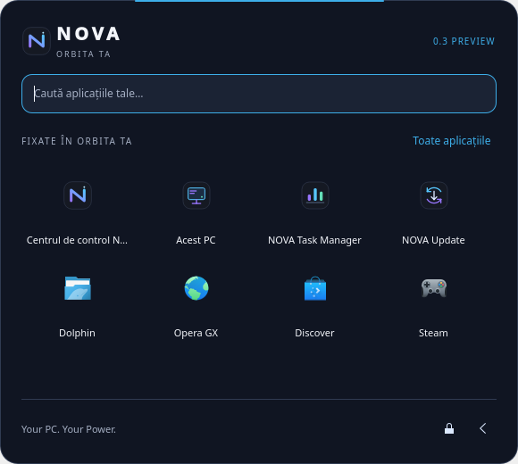
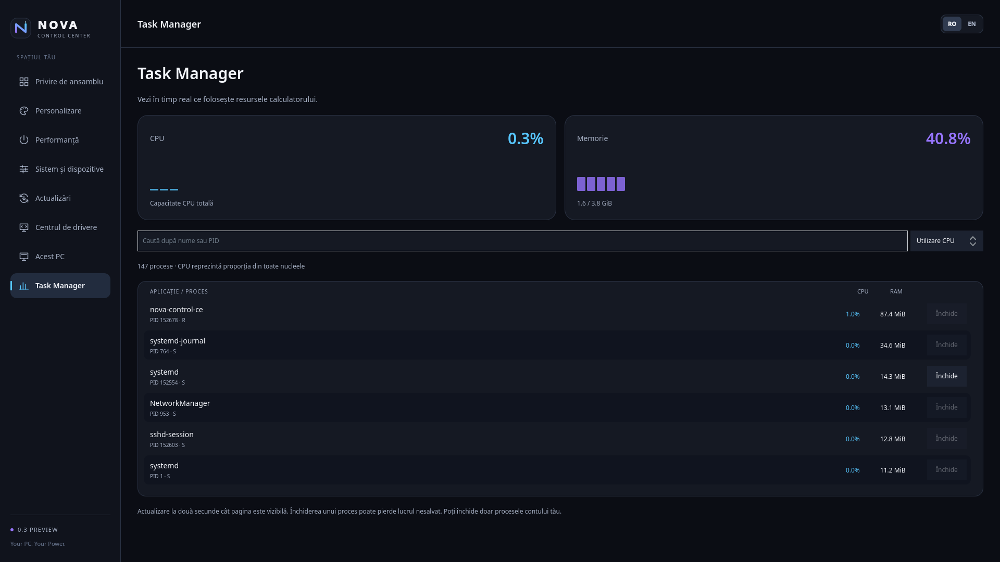
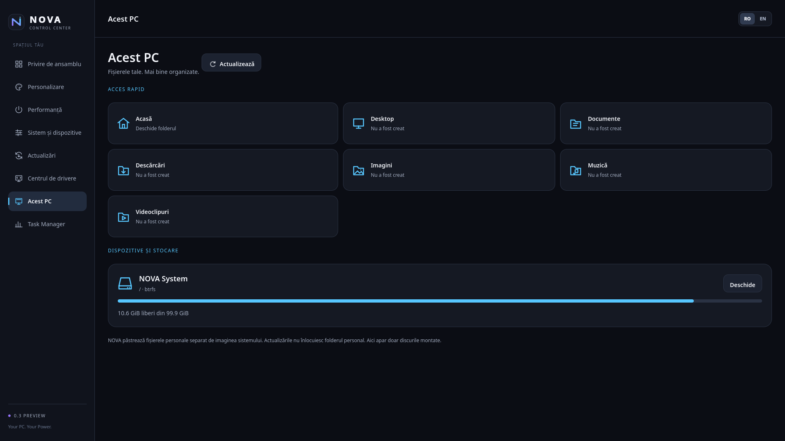
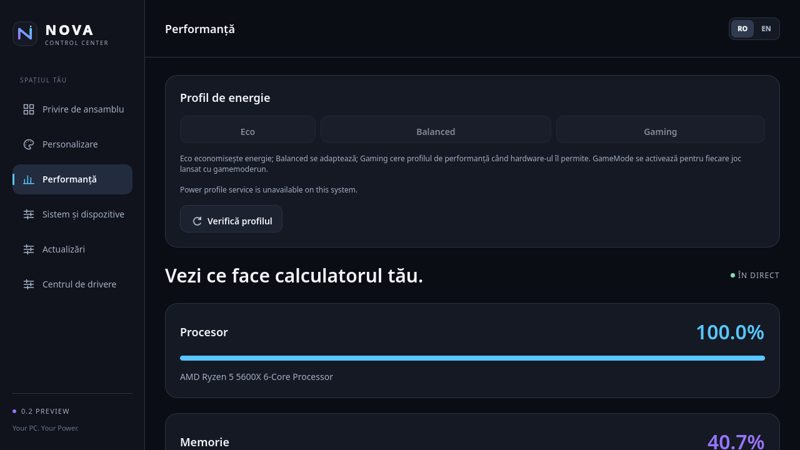
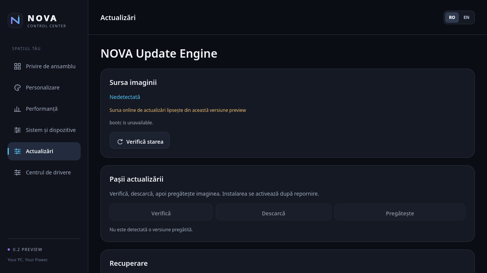
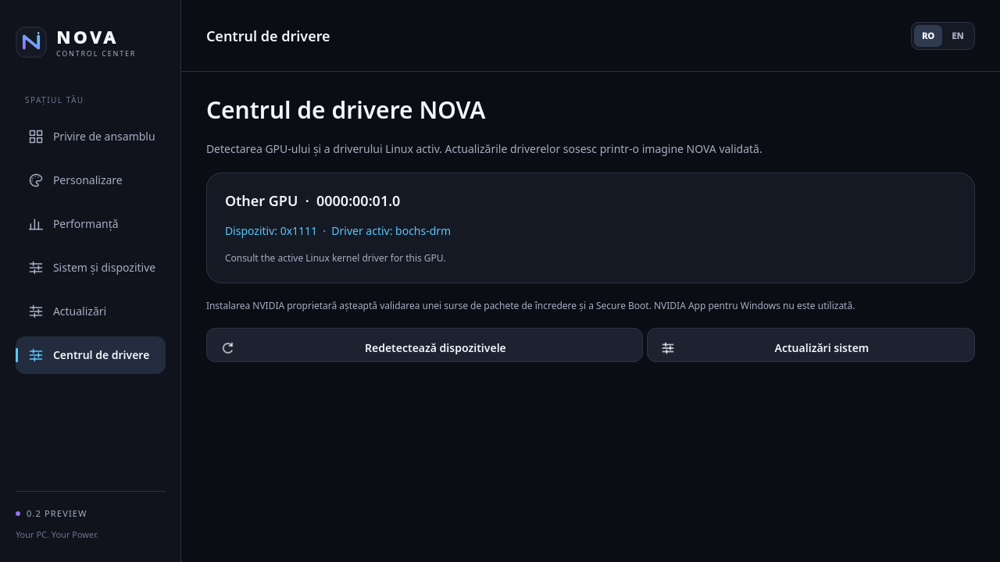

# NOVA OS — Your PC. Your Power.

**0.3.1 Preview is published:** the Steam/Opera GX first-install repair is
available from **NOVA Settings → Updates → Check for updates → Download & install**.
Restart to enter the new system image, then open Steam and confirm its application
installation in Discover. No NOVA reinstall is needed. See the
[update evidence and limits](docs/UPDATE-0.3.1.md).

NOVA 0.3 adds an in-system update channel, NOVA Start, This PC, Task Manager,
orbital boot animation and an original sound theme.
See the [0.3 implementation and validation limits](docs/NOVA-0.3.md).
Steam first-install error in the delivered Preview: see the
[repair instructions and source fix](docs/STORE-TROUBLESHOOTING.md).
The local 0.3 ISO has completed offline plain ext4 installation and a boot/login
without the ISO in a disposable UEFI VM. The public Preview channel now points
to 0.3.1; physical hardware and broader release acceptance remain open.

The native 0.3 applications and local runtime image have been built. Seven
CTest suites pass, and real keyboard search/launch was exercised in the NOVA
Start applet. [Observed results and remaining checks](docs/VALIDATION-0.3.md).







These are native development captures, not proof of an installed 0.3 system.

NOVA OS is an experimental desktop operating system based on Fedora Kinoite 44,
KDE Plasma 6 and bootc images. It combines a cosmic desktop theme with a native
C++ / Qt 6 / QML / Kirigami Control Center. No online NOVA account is required.

**0.2 Preview has known installation failures. It is a development snapshot,
not a stable release or a recommended installation on a personal computer.**
Read the [installer issues](docs/INSTALLER-ISSUES.md) before image experiments.
The staging correction has now passed one whole-disk offline case in the local
0.3 ISO; this does not close the original HP report or validate other layouts.
Git excludes generated ISO, VM and executable files. Local kit provenance and
test limits are described in [VALIDATION-0.3.md](docs/VALIDATION-0.3.md).

These are the [original NOVA sources](docs/SOURCE-PROVENANCE.md), including the
installer staging integration. Original NOVA code, documentation and graphics are
available under the MIT license. Third-party components retain their own terms;
see [LICENSE](LICENSE), [NOTICE.md](NOTICE.md) and [licensing review](docs/LICENSING.md).

## Historical 0.2.1 Preview update

The 0.2.1 Preview branch improves Wine launch diagnostics, configures signed
Flathub metadata for Discover, and adds NOVA launchers for Steam and Opera GX.
Those launchers open the application's Discover page when it is not installed;
the proprietary application binaries are not embedded in the NOVA image. Wine
does not guarantee that a Windows application or game will work.

This branch configures the image update target as
`ghcr.io/dennics/nova-os:0.2.1-preview`. Existing 0.2.0 installations still
point at `nova.invalid` and need this one-time source migration after the
public image is available:

```sh
pkexec bootc switch ghcr.io/dennics/nova-os:0.2.1-preview
```

Restart after bootc stages the image. Later registry updates are handled from
NOVA Settings. See [UPDATE-0.2.1.md](docs/UPDATE-0.2.1.md) for the procedure
and its validation limits.

The installer wrapper now stages image import in a separate, disk-backed
temporary filesystem and checks available space before deployment. This is a
targeted correction for the reported root-directory and temporary-storage
failures. The subsequent local 0.3 ISO has completed one offline VM installation;
the full matrix in ACCEPTANCE.md still applies.

## Implemented components

| Component | Implemented behavior | Preview limits |
| --- | --- | --- |
| Control Center | Native UI, system information, CPU/RAM sampling, KConfig preferences, first-login welcome, Romanian/English UI | Desktop/hardware behavior needs testing beyond unit tests |
| NOVA Dark | Plasma look-and-feel, colors, bottom panel, original SVG wallpaper/mark and motion preferences | Plasma provides desktop infrastructure; GPU effects vary |
| Smart Compatibility | Local PE inspection, architecture checks, limited native-app hints, explicit Wine launch with process results and per-launch logs, shared/per-app prefixes, Dolphin integration | Hints use untrusted metadata; Wine is not a sandbox and execution is not guaranteed |
| Update Center | bootc status and fixed operations through polkit; published moving NOVA Preview channel | 0.3.0 → 0.3.1 deployment, cold boot and rollback checked in a VM; HP validation and warm-reboot limitations remain |
| Performance Profiles | Eco/Balanced/Gaming request power-saver/balanced/performance over D-Bus | Requires service/hardware support; GameMode is used by explicitly launched games; no FPS claims |
| Driver Center | PCI GPU/vendor and active Linux driver detection with guidance | No proprietary NVIDIA driver installer |
| Installer | Anaconda Live/WebUI, offline payload, explicit disk selection and isolated space-checked staging; local 0.3 plain ext4 whole-disk installation passed in an offline VM | HP hardware, manual partitioning, encryption and interrupted/retried installation are not validated for this ISO |
| Applications/archives | Opera GX and Steam launchers open Discover pages; Ark, unar and 7zip handle ZIP/RAR/7z | Browser/game binaries are installed separately; Wine cannot run every Windows app; RAR creation is absent |
| Windows USB tool | Native C# frontend pinned to the local 0.3 ISO, protected Fedora helper cache, explicit erase confirmation, safe self-test and ZIP64 kit packager | Physical USB writing untested; unsigned executable; generated binaries/payloads excluded from Git |

## Real application screenshots

These captures show the running NOVA application in development environments,
not design mockups. Unavailable services are visible. Momentary CPU/RAM values
are not benchmarks. The UI shown is Romanian.







These images do not demonstrate successful installation.
[Screenshot provenance](docs/screenshots/README.md) records their origin/hashes.

## Architecture and layout

The runtime OCI image contains Plasma and NOVA applications. A separate Live
image adds Anaconda and a temporary Live account. Image Builder embeds the runtime
payload in `bootc-generic-iso` for offline installation. bootc manages system
deployments; user state is separate. Normal NOVA applications are unprivileged;
system services and polkit authorize administrative actions. Configuration keeps
SELinux enforcing and enables the firewall; every delivered image must verify both.

| Path | Purpose |
| --- | --- |
| `src/`, `ui/`, `assets/` | Native applications, compatibility inspector and original graphics |
| `system/` | Installed-system configuration, Plasma, MIME and polkit integration |
| `installer/` | Live-only Anaconda settings, defaults and bootc wrapper |
| `Containerfile`, `Containerfile.build-tools` | Runtime, Live and ISO build-tool stages |
| `sources.lock.json`, `scripts/` | Image pins, build pipeline and osbuild integration |
| `tests/` | Existing C++ tests, read-only guest probe and RAR fixture |
| `tools/nova-media-creator/` | Windows utility source |
| `tools/host.py` | Original Windows/QEMU helper; requires its documented workspace layout |
| `docs/` | Architecture, building, validation and release preparation |

See [ARCHITECTURE.md](docs/ARCHITECTURE.md) for component boundaries and
[VALIDATION.md](docs/VALIDATION.md) for the actual evidence and gaps.

## Build and VM testing

Use a disposable Fedora 44 development VM. Install the dependencies in
[BUILD.md](docs/BUILD.md), then compile the native applications:

```sh
cmake -S . -B build/native -G Ninja -DCMAKE_BUILD_TYPE=Release -DCMAKE_INSTALL_PREFIX=/usr
cmake --build build/native -j2
ctest --test-dir build/native --output-on-failure
```

The image pipeline is `sudo bash scripts/build.sh iso`, using the Fedora base
and Image Builder digests in `sources.lock.json`. Current runtime configuration
offers Opera GX through Discover rather than embedding proprietary binaries.
The local 0.3 validation reused the verified 0.2.1 runtime as its explicit build
base; it is not a clean-host reproducibility result. Fedora package repositories
are not snapshot-pinned. See [BUILD.md](docs/BUILD.md) for dependencies and the
recorded provenance; bit-identical ISO output is not promised.

Run publication checks with Python 3.10+ and Git:

```sh
python3 scripts/audit-publication.py
```

Full installation must use an unmodified rebuilt ISO with no virtual NIC and a
disposable target disk. [VM.md](docs/VM.md) and [ACCEPTANCE.md](docs/ACCEPTANCE.md)
define the full acceptance gate. The local 0.3 plain installation case has passed;
hardware, encryption, manual layouts and online update/rollback remain open.

## Hardware and development resources

No general hardware minimum or compatibility list has been established. The
development target is x86_64/UEFI. Previous VM work used 4 virtual CPUs, 6–8 GiB RAM
and a 48 GiB test disk; the builder uses a 100 GB disk. These are development
configurations, not supported minima. Plan 8 GiB guest RAM for new experiments
and sufficient host memory/storage for OCI layers and intermediates; run builder
and test guests one at a time on a constrained host.

An HP laptop with 8 GB RAM, integrated graphics and a 128 GB SATA SSD was reported
to fail during installation. That is a known failure, not hardware certification.
Secure Boot, dual boot, proprietary GPU drivers and physical gaming performance
remain unvalidated.

## Roadmap and contributions

The immediate priorities are safe installer staging, offline installation/first
boot, and removal of private-bootstrap build dependencies. Later work includes
physical hardware validation, Steam/Proton/GameMode integration, recovery/Defender
UI, and eventually NOVA AI/NOVA ID. These later services are planned, not shipped.
See [ROADMAP.md](docs/ROADMAP.md).

Use [GitHub Issues](https://github.com/dennics/NOVA-OS/issues) for non-sensitive
reproducible bugs. Follow [CONTRIBUTING.md](CONTRIBUTING.md) for changes and
[SECURITY.md](SECURITY.md) for sensitive reports. No stable support SLA is promised.
