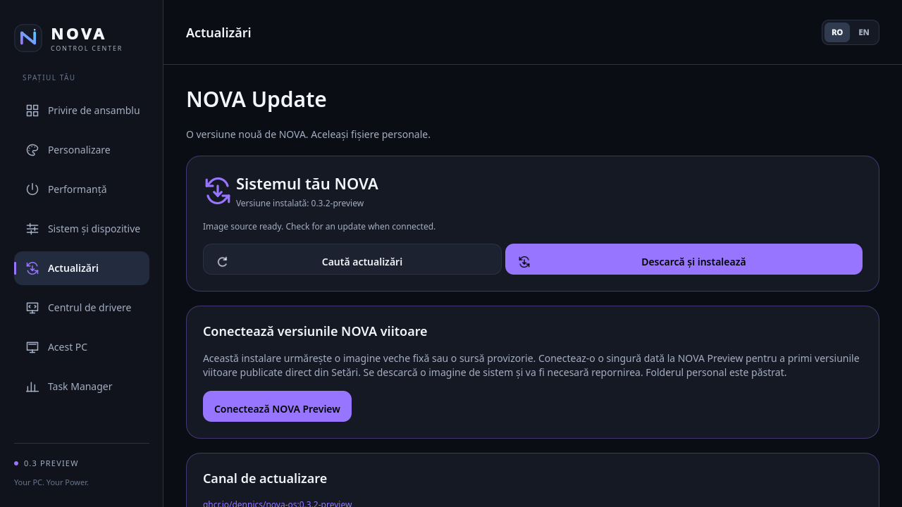

# NOVA OS 0.3.2 Preview — Settings status repair

Published on 2026-10-23. Both the numbered image and moving Preview channel
resolve anonymously to the digest below; installed-user acceptance has passed.
Do not infer a physical HP or game validation from this report.

## Why a one-time bootstrap is necessary

Final installed-user testing of 0.3.1 found that `bootc status --format=json
--format-version=1` fails without root privilege on the deployed bootc version.
The old Settings backend invoked it directly as the desktop user. Status stayed
unavailable and the GUI's Live/source guards disabled the update actions, even
though the public registry and root-run update helper worked.

An already installed 0.3.0/0.3.1 GUI cannot acquire its own repair through those
disabled controls. Run this once in Konsole as the ordinary desktop user:

```sh
pkexec /usr/libexec/nova-update-helper install
```

Authenticate using the installed system's normal administrator prompt. Wait for
the update to finish, then restart. This is the existing OS update backend:
it retains bootc's staging/rollback, source checks and 8 GiB space preflight.
It does not reinstall NOVA from an ISO. After the fixed image is running,
future published Preview images can be requested from NOVA Settings → Updates.

## Permission boundary

The rebuilt Control Center delegates status to `pkexec
/usr/libexec/nova-update-status`. That root-owned helper accepts no arguments
and only runs the fixed bootc JSON status command, with a 15-second timeout.
The separate `org.novaos.update.status` policy permits active local sessions to
read this machine status; inactive/other sessions are denied. No root GUI,
general command runner, service or permissive SELinux rule is introduced.

The existing administrative helper and `org.novaos.update` policy still require
administrator authentication for checks, installation, source changes and
rollback. Installation does not become implicitly authorized by status access.

## Build and observed checks

`scripts/build-settings-update.sh` verifies the exact local 0.3.1 parent, builds
the native Control Center and its update/process test, and builds the targeted
`Containerfile.update-repair`. The normal full Containerfile also includes the
new status helper on future full source builds.

- Native update/process suite passed, including a new regression proving that
  the desktop obtains usable update state through only the dedicated read helper.
- The image rejected an `install` argument to the status helper with exit 2.
- Policy inspection confirmed active-local read access, inactive denial and
  unchanged `auth_admin` on the administrative helper.
- bootc container lint passed 14 checks and skipped one.
- Steam/Opera GX repair is inherited from 0.3.1; no application binaries or
  new kernel are added.

Local image ID:

```
5f495f86fce5b1b971d1fc26b11bba72ce61b43687f96b4632c6af06e329b47b
```

Published numbered reference: `ghcr.io/dennics/nova-os:0.3.2-preview`.
Manifest digest:

```
sha256:056d0b939e98e83242f086430f4e70738ff95c878be70317aadd289c9a0e0fd5
```

## Installed-user validation, 2026-10-23

An installed NOVA 0.3.0 disposable UEFI VM fetched the public numbered image
without registry credentials. bootc reused 266 layers and fetched four layers
(297.1 kB in this specific VM); deployment completed in 15 seconds. Cold boot
entered the exact 0.3.2 digest above, with 0.3.0 available as rollback. The
existing personal-file SHA-256 and preferences persisted; SELinux was Enforcing
and firewalld active.

From an active local console session with UID 1000, `pkexec
--disable-internal-agent /usr/libexec/nova-update-status` returned valid installed
status without an administrator prompt. The native Control Center, also UID 1000,
rendered its actual Updates page with the installed 0.3.2 version, source-ready
state and enabled Check/Download buttons. The capture uses Qt's offscreen software
renderer in that active session, not a design mockup or a root GUI. Its Connect
Preview card is expected because this acceptance step used a numbered reference.



Existing QML dialog implicit-height binding warnings appeared in the offscreen
log. This check does not validate all recovery/source-confirmation dialog layouts.

After promotion, the VM was cold-booted back into 0.3.0 using rollback. From an
active local UID 1000 session, the exact `pkexec /usr/libexec/nova-update-helper
install` command requested the existing `org.novaos.update` administrator
authentication. The fixture administrator password was accepted; the helper
returned exit 0 and staged the exact 0.3.2 digest on the moving Preview source.
Deployment completed in 16 seconds in this VM. This validates the documented
legacy bootstrap through the already installed updater, separately from the
earlier cold boot and ordinary-user Settings check of the same image.

The Windows QEMU/WHPX warm-reset limitation from [0.3.1](UPDATE-0.3.1.md)
still applies. User data, installation on the physical HP, Steam application
installation and games are not remotely verified by this build.
